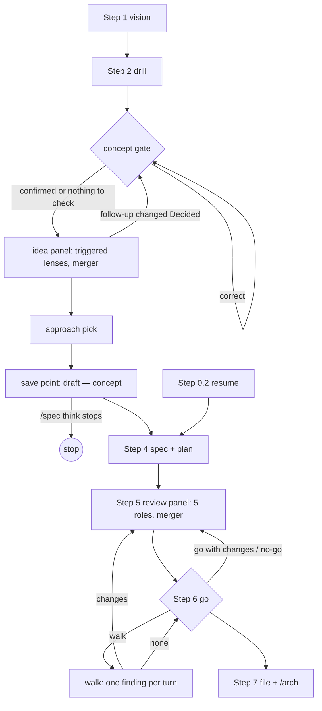

# spec — architecture

Spec: `docs/spec/think-and-review.md` (§ 4.6 holds the file tree).

## Decisions
- SKILL.md holds the step outline, numbered 0–8. Three reference files hold the think-and-review procedures: `references/think.md`, `references/lenses.md` and `references/review.md`. This keeps SKILL.md small, under the limit `docs/reqs.md` sets.
- One lens file serves both panels. It holds 7 idea lenses and 5 review roles. The two lists cannot drift apart. Each idea lens has its own **Runs** trigger in this file. The dispatcher reads the trigger, and the lens agent does not get it. Thus each lens has one definition, and its trigger cannot drift from it.
- One Checks table in `references/review.md` lists every review check with its group and owning role. The single reviewer gets the whole table, and each panel role gets its rows. One list cannot drift from another.
- The walk at the go lives in `references/review.md` § Walk at the go, beside § Closing findings. SKILL.md Step 6 only points to it. Findings are review.md's, and SKILL.md stays under its byte cap. Spec: `docs/spec/go-walkthrough.md`.
- The idea lenses run on `sonnet`. The review roles, the merger and every reviewer run on the session model. In an A/B run on the toy fixture, `sonnet` lenses caught the seeded problem at a lower cost. Review roles on `sonnet` missed a Critical (`docs/spec/think-and-review-spikes.md` § Model A/B).
- Panel agents write their reports to scratchpad files. A merger returns the counts and the path. This keeps the panel output out of the main conversation.
- The write check reuses `~/.agents/skills/_shared/scripts/checks.sh fp`, the content fingerprint the check log already uses. A change to its output format reaches /spec too.

## Flow (full mode, new feature)

Light mode, post-build mode and spec-only re-runs go from Step 1 to the batch
(`references/questions.md`) and on to one reviewer at Step 5.
